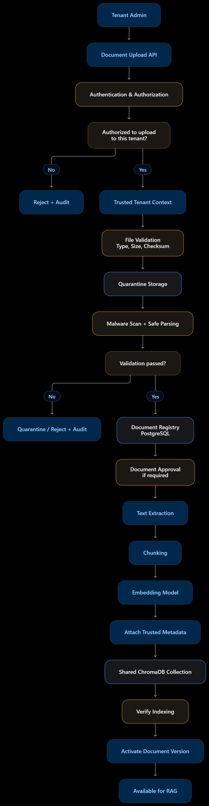
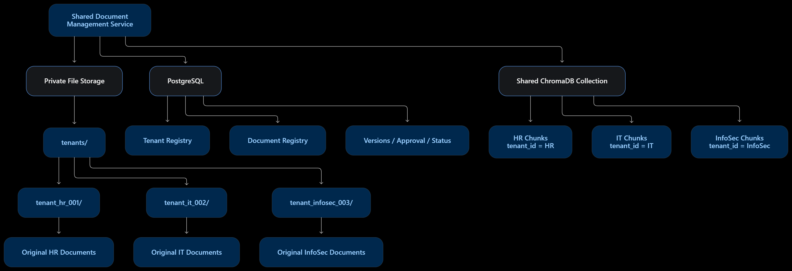

# Document storage and ingestion pipeline

Atlas separates document management into three stores:

- Local private storage preserves original files under generated paths.
- PostgreSQL is authoritative for ownership, approval, versions, lifecycle, and audit history.
- One shared ChromaDB collection, `organization_knowledge`, stores searchable chunks.

## Architecture diagrams

### Document upload and ingestion



### Shared document storage



## Storage layout

Runtime data is ignored by Git and created on demand:

```text
storage/
└── tenants/
    └── tenant_<slug>_<database-id>/
        ├── originals/
        └── quarantine/

chroma_data/
└── organization_knowledge
```

Uploader filenames are kept in PostgreSQL for display. Filesystem names and
document/version identifiers are generated by the trusted backend.

## Lifecycle

1. Authenticate the uploader and resolve the tenant from trusted context.
2. Enforce extension, size, signature, archive, UTF-8, and malware checks.
3. Write to quarantine while calculating a SHA-256 checksum.
4. Move validated originals into private tenant storage and register the version.
5. Platform-admin uploads are approved and queued immediately. Tenant-manager
   uploads wait for platform-admin approval.
6. A background task extracts text, chunks it, generates embeddings, and upserts
   the chunks into the shared Chroma collection.
7. Verify every expected Chroma ID before activating the PostgreSQL version.
8. Only after activation is the previous version superseded and removed from Chroma.

Failed or rejected versions never become searchable. Revocation updates PostgreSQL
first, immediately removing retrieval authorization even if physical vector cleanup
must be retried.

## Trusted vector metadata

Each chunk receives backend-generated metadata:

```json
{
  "tenant_id": "tenant_hr_001",
  "tenant_db_id": 1,
  "document_id": "doc_83f2...",
  "version_id": "ver_a912...",
  "chunk_id": "ver_a912..._chunk_000001",
  "access_scope": "employee",
  "status": "active"
}
```

Retrieval applies mandatory Chroma filters and then verifies every returned
`version_id` against active PostgreSQL records. Physical collection sharing is
therefore not treated as an authorization boundary.

## API routes

Tenant manager routes derive the tenant exclusively from the signed-in account:

- `POST /api/manager/documents`
- `POST /api/manager/documents/{document_id}/versions`
- `GET /api/manager/documents`
- `POST /api/manager/documents/{document_id}/reindex`
- `DELETE /api/manager/documents/{document_id}`

Platform administrator routes validate the target tenant in PostgreSQL:

- `POST /api/admin/tenants/{tenant_id}/documents`
- `POST /api/admin/tenants/{tenant_id}/documents/{document_id}/versions`
- `GET /api/admin/tenants/{tenant_id}/documents`
- `POST /api/admin/documents/{version_id}/approve`
- `POST /api/admin/documents/{version_id}/reject`
- `POST /api/admin/tenants/{tenant_id}/documents/{document_id}/reindex`
- `DELETE /api/admin/tenants/{tenant_id}/documents/{document_id}`

## Security configuration

See `.env.example` for available settings. `DOCUMENT_SCANNER_MODE=basic` provides
strict development validation and EICAR detection. Production deployments should
set `DOCUMENT_SCANNER_MODE=clamav` and configure `CLAMAV_COMMAND`. ClamAV mode
fails closed when the scanner is unavailable.

Originals are retained after logical deletion for later retention-policy handling.
PostgreSQL revocation and vector deletion happen immediately.
