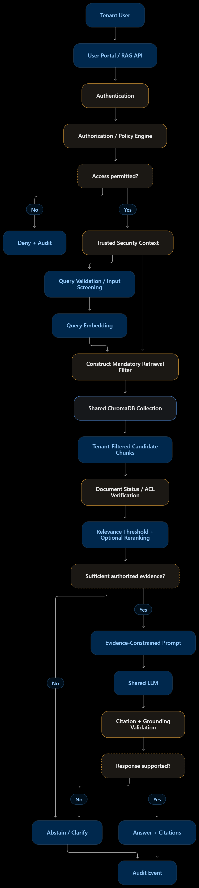

# Tenant-aware RAG query pipeline

The runtime query pipeline is separate from document ingestion. Documents are
embedded once during approved ingestion; a user question creates only a query
embedding.

## Runtime diagram



## Module boundaries

The implementation lives in `src/multi_tenant_rag_assistants/RAG/`:

- `security.py` revalidates the authenticated user, active tenant, role, and scopes.
- `screening.py` normalizes and validates the question.
- `retrieval.py` constructs the mandatory tenant filter before querying ChromaDB,
  then independently checks document and version authorization in PostgreSQL.
- `threats.py` detects prompt-injection, tenant-escape, exfiltration, poisoning,
  hidden-markup, and concealed-Unicode indicators without invoking an LLM.
- `incidents.py` persists privacy-conscious security reports for blocked requests.
- `prompting.py` builds an evidence-only prompt and treats retrieved text as data.
- `generation.py` is the replaceable OpenAI chat-model adapter.
- `grounding.py` rejects answers with missing or invalid source references.
- `audit.py` writes privacy-conscious query events without storing raw questions.
- `service.py` orchestrates the components without depending on FastAPI.
- `api.py` exposes the transport at `POST /api/rag/query`.

## Security boundary

The browser submits only a question and an optional result count. It cannot submit
a tenant ID, user role, or access scope. Those values are derived from the signed
session and revalidated against active PostgreSQL records.

The security context also requires the tenant's active Tenant Domain Contract.
The contract's canonical JSON is SHA-256 hashed and HMAC-signed. Missing, invalid,
or tampered policy fails closed before retrieval. The active version supplies role
capabilities and access scopes. The restored RAG path continues to use its original
environment-configured retrieval limits and distance threshold.

New tenants remain inactive during onboarding. Their initial contract is a draft,
and they cannot reach this query pipeline until that contract is approved and
activated.

ChromaDB is always queried with a server-built filter resembling:

```python
{
    "$and": [
        {"tenant_id": {"$eq": trusted_context.tenant_key}},
        {"status": {"$eq": "active"}},
        {"access_scope": {"$in": trusted_context.access_scopes}},
    ]
}
```

There is no unfiltered search followed by tenant filtering. Returned metadata is
still treated as untrusted: every result must match an active document's current
active version and allowed scope in PostgreSQL before it can become a retrieval
candidate. Results remain in vector-distance order; no lexical reranking is applied.

Regular users can retrieve `employee` documents. Tenant managers can retrieve
`employee` and `management` documents belonging to their own tenant. Platform
administrators do not have chatbot access.

## Threat screening and incident response

The service screens both the user question and every authorized retrieved chunk
before generation. Indicators include instruction override attempts, role
reassignment, cross-tenant requests, protected-data extraction, citation
suppression, hidden CSS, zero-width characters, and bidirectional Unicode controls.

When a finding is detected:

1. generation is not called and the assistant returns a generic security-review
   response;
2. the query audit records a `denied` outcome and incident IDs;
3. one or more `rag_security_incidents` rows record tenant, actor, request,
   contract version, source, severity, category, indicators, timestamp, and—when
   applicable—document/version/chunk IDs;
4. evidence is represented by a SHA-256 hash and a short redacted excerpt rather
   than an unrestricted copy of the prompt; and
5. tenant managers see only their tenant's reports, while platform administrators
   can review reports across tenants. Both roles can acknowledge and resolve them.

The detector is intentionally deterministic and conservative. It is an enforcement
layer, not a malware scanner or proof that content is safe. See
[`security-incident-response.md`](security-incident-response.md) for the response
workflow and data-handling rules.

## Grounding and abstention

The generator is instructed to use only authorized evidence and cite it inline as
`[1]`, `[2]`, and so on. The backend validates every cited number. When retrieval
finds no sufficiently relevant authorized chunks, or the generated response has no
valid citation, the service returns a fixed abstention instead of an unsupported
answer. Citation validation checks that referenced source numbers exist; it does
not perform the removed sentence-level lexical-support calculation.

The response includes display-safe citation records containing the original
filename, document/version/chunk identifiers, and a short excerpt. The frontend
renders these as expandable sources using text-only DOM APIs.

## Audit data

`rag_query_audit` records the tenant, actor, outcome, result counts, latency, and a
SHA-256 hash of the normalized query. It also records the active contract ID and
version. Raw question text is deliberately not stored.
Outcomes are `answered`, `abstained`, `denied`, or `failed`.

## Configuration

- `RAG_CHAT_MODEL` defaults to `gpt-4o-mini`.
- `RAG_TOP_K` defaults to `5` and the API caps it at `10`.
- `RAG_MAX_DISTANCE` defaults to `0.8` for cosine-distance filtering.
- `DOCUMENT_EMBEDDING_MODEL` is shared with ingestion and defaults to
  `text-embedding-3-small`; ingestion and query embeddings must use the same model.

## Phase 2 verification boundary

Automated tests cover mandatory pre-query tenant filters, PostgreSQL revalidation,
cross-tenant negative retrieval, role-derived access scopes, tampered-contract
failure, security screening before generation, incident visibility, citation
abstention, query auditing, and authenticated API context. The real OpenAI
embedding-and-generation smoke test is opt-in through `RUN_OPENAI_RAG_TESTS=1`.

Phase 2 deliberately retains vector-distance ordering without hybrid retrieval or
reranking. Provider-agnostic routing and metric-first BI are future work.
