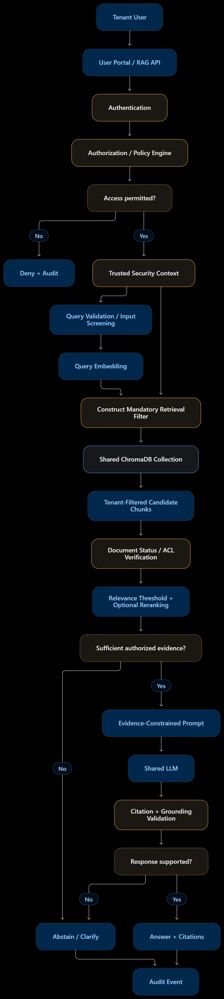

# Tenant-aware RAG query pipeline

The runtime query pipeline is separate from document ingestion. Documents are
embedded once during approved ingestion; a user question creates only a query
embedding.

## Runtime diagram



## Module boundaries

The implementation lives in `src/multi_tenant_rag_assistants/RAG/`:

- `security.py` revalidates the authenticated user, active tenant, role, and scopes.
- `screening.py` normalizes and validates the question.
- `retrieval.py` constructs the mandatory tenant filter before querying ChromaDB,
  then independently checks document and version authorization in PostgreSQL.
- `prompting.py` builds an evidence-only prompt and treats retrieved text as data.
- `generation.py` is the replaceable OpenAI chat-model adapter.
- `grounding.py` rejects answers with missing or invalid source references.
- `audit.py` writes privacy-conscious query events without storing raw questions.
- `service.py` orchestrates the components without depending on FastAPI.
- `api.py` exposes the transport at `POST /api/rag/query`.

## Security boundary

The browser submits only a question and an optional result count. It cannot submit
a tenant ID, user role, or access scope. Those values are derived from the signed
session and revalidated against active PostgreSQL records.

ChromaDB is always queried with a server-built filter resembling:

```python
{
    "$and": [
        {"tenant_id": {"$eq": trusted_context.tenant_key}},
        {"status": {"$eq": "active"}},
        {"access_scope": {"$in": trusted_context.access_scopes}},
    ]
}
```

There is no unfiltered search followed by tenant filtering. Returned metadata is
still treated as untrusted: every result must match an active document's current
active version and allowed scope in PostgreSQL before it can enter the LLM prompt.

Regular users can retrieve `employee` documents. Tenant managers can retrieve
`employee` and `management` documents belonging to their own tenant. Platform
administrators do not have chatbot access.

## Grounding and abstention

The generator is instructed to use only authorized evidence and cite it inline as
`[1]`, `[2]`, and so on. The backend validates every cited number. When retrieval
finds no sufficiently relevant authorized chunks, or the generated response has no
valid citation, the service returns a fixed abstention instead of an unsupported
answer.

The response includes display-safe citation records containing the original
filename, document/version/chunk identifiers, and a short excerpt. The frontend
renders these as expandable sources using text-only DOM APIs.

## Audit data

`rag_query_audit` records the tenant, actor, outcome, result counts, latency, and a
SHA-256 hash of the normalized query. Raw question text is deliberately not stored.
Outcomes are `answered`, `abstained`, `denied`, or `failed`.

## Configuration

- `RAG_CHAT_MODEL` defaults to `gpt-4o-mini`.
- `RAG_TOP_K` defaults to `5` and the API caps it at `10`.
- `RAG_MAX_DISTANCE` defaults to `0.8` for cosine-distance filtering.
- `DOCUMENT_EMBEDDING_MODEL` is shared with ingestion and defaults to
  `text-embedding-3-small`; ingestion and query embeddings must use the same model.
